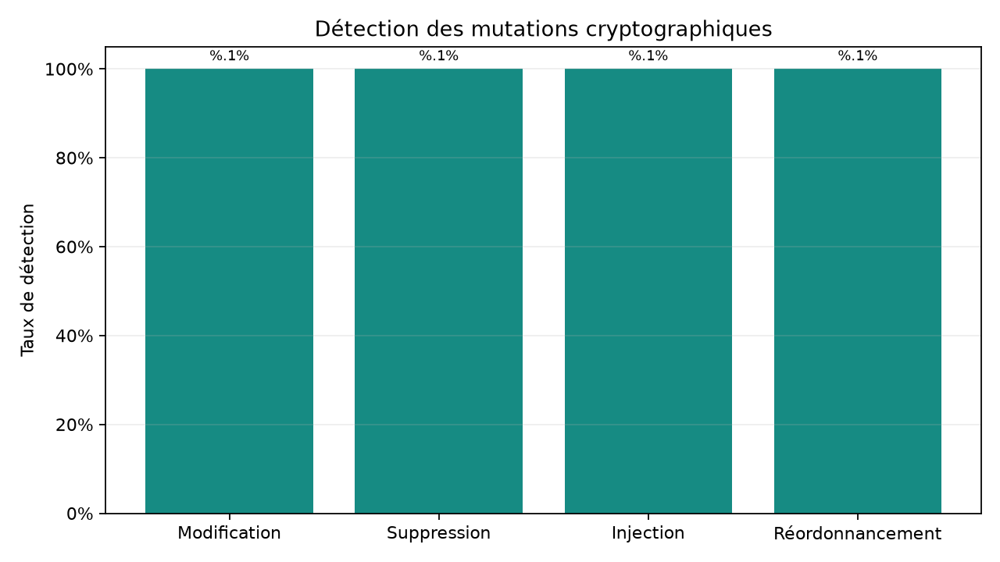
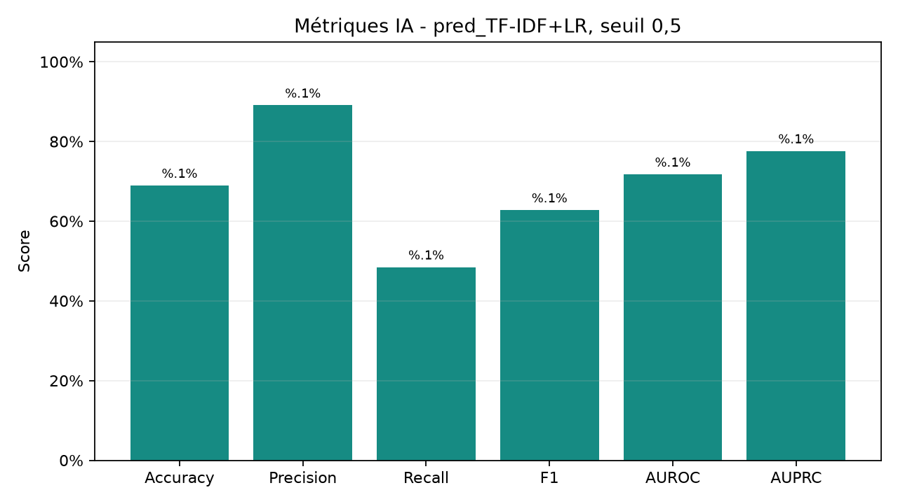
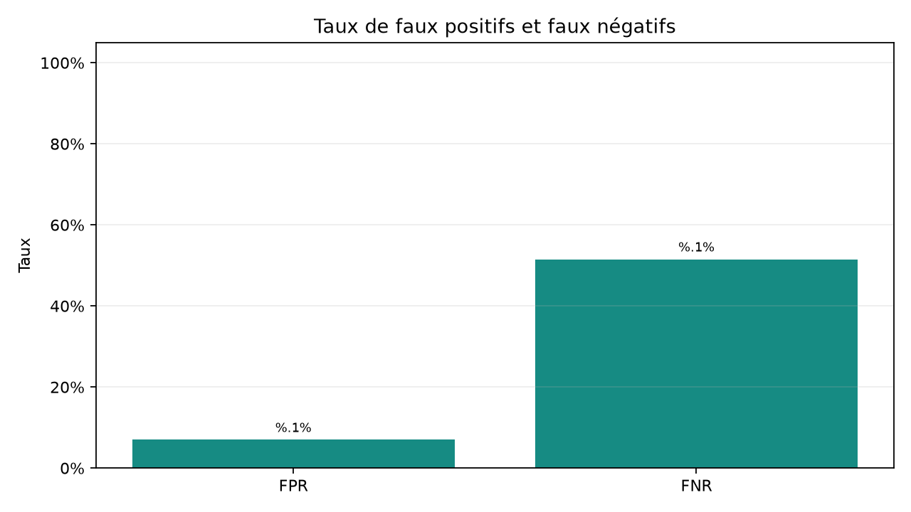
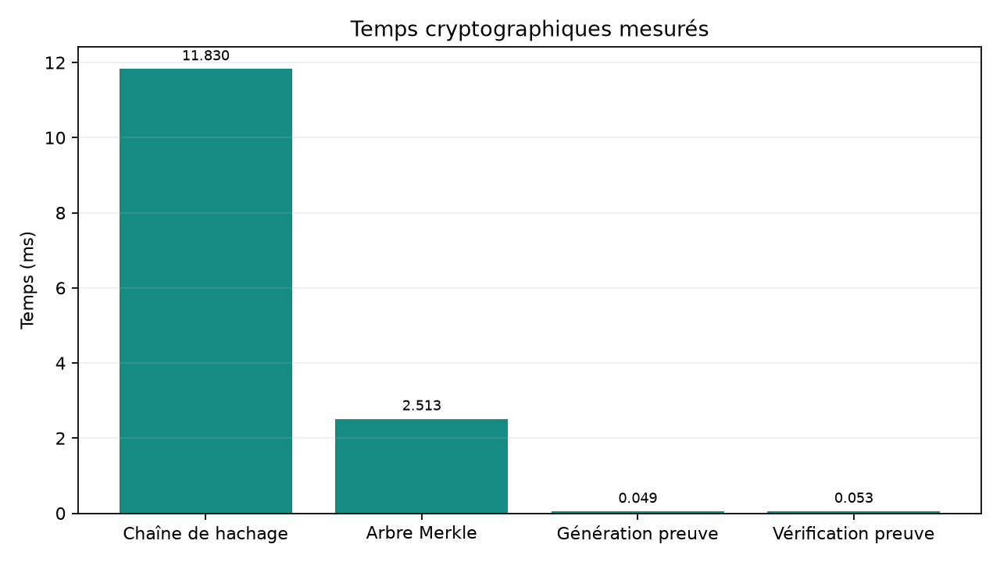
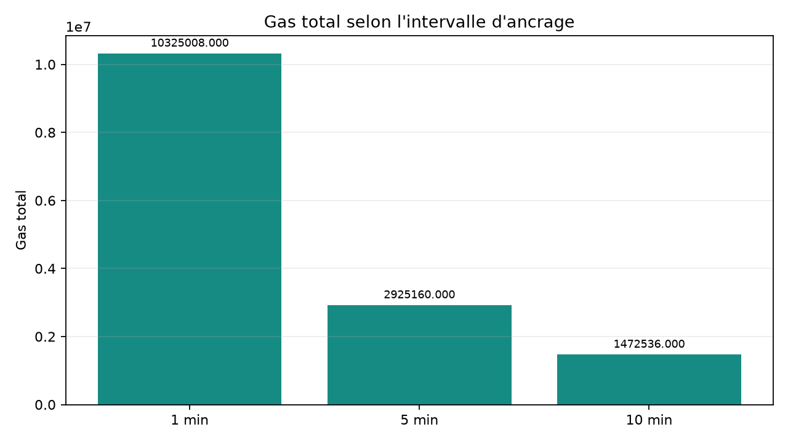

# Audit de logs : résultats et reproduction

Ce dépôt rassemble les scripts, les données de travail disponibles et les
résultats des volets de prétraitement, falsification, chaîne cryptographique,
détection IA et ancrage blockchain. Les rapports et les figures ci-dessous
sont des sorties calculées à partir des artefacts livrés dans `data/processed/`.

## Résultats

### Vérification cryptographique

Les quatre mutations déterministes testées (modification, suppression,
injection et réordonnancement) sont détectées dans les essais rapportés.
Les temps mesurés de génération de la chaîne, construction de l'arbre Merkle,
génération et vérification de preuve sont inscrits dans le rapport JSON et
illustrés ci-dessous; ils varient selon la machine et la charge du système.
La preuve sérialisée mesure en moyenne 899,7 octets.



### Détection IA

Évaluation de `pred_TF-IDF+LR` au seuil `0.5` sur 26 206 échantillons :

| Accuracy | Precision | Recall | F1 | AUROC | AUPRC | FPR | FNR |
| ---: | ---: | ---: | ---: | ---: | ---: | ---: | ---: |
| 68,96 % | 89,08 % | 48,47 % | 62,78 % | 71,76 % | 77,61 % | 6,98 % | 51,53 % |

Le rappel de 48,47 % et le taux de faux négatifs de 51,53 % sont des limites
importantes pour un détecteur de sécurité. La précision seule ne suffit pas à
juger le modèle; la sélection du seuil doit privilégier le rappel en tenant
compte des faux positifs.





### Ancrage blockchain

| Intervalle | Transactions | Gas moyen/ancrage | Gas total | Latence moyenne | Débit | Stockage on-chain |
| ---: | ---: | ---: | ---: | ---: | ---: | ---: |
| 1 min | 28 | 368 750,3 | 10 325 008 | 0,0229 s | 7 814,97 logs/s | 8 540 octets |
| 5 min | 8 | 365 645 | 2 925 160 | 0,0212 s | 29 481,13 logs/s | 2 440 octets |
| 10 min | 4 | 368 134 | 1 472 536 | 0,0216 s | 57 803,47 logs/s | 1 220 octets |

L'intervalle de 10 minutes présente le débit mesuré le plus élevé et le coût
total le plus faible, mais retarde l'ancrage des lots. Le stockage off-chain
n'est pas mesuré dans les artefacts fournis.





Les résultats détaillés, dont le rappel par type d'attaque, sont dans
[`results/tables/metrics_report.json`](results/tables/metrics_report.json) et
[`results/tables/metrics_summary.csv`](results/tables/metrics_summary.csv).
Les figures de comparaison des modèles IA provenant des résultats originaux
sont dans [`results/figures/ai_models/`](results/figures/ai_models/).

## Installation et reproduction

Python 3.10 ou plus récent :

```bash
python -m venv .venv
python -m pip install -r requirements-lock.txt
python scripts/regenerate_all.py
python scripts/verify_reproducibility.py
pytest -q
```

Le régénérateur calcule le rapport JSON/CSV, produit cinq figures et crée un
manifeste SHA-256 des entrées et sorties dans `results/manifests/`.
`data/processed/` contient les entrées utilisées par cette évaluation; les
fichiers bruts originaux ne sont pas inclus. Voir [`data/README.md`](data/README.md)
et les documents de [`docs/`](docs/) pour les détails, la méthodologie et les
limites.

## Contrat blockchain

```bash
cd contracts
npm ci
npx hardhat test
```

## Structure

- `src/`: implémentations de prétraitement, falsification, cryptographie,
  détection IA et blockchain.
- `tests/`: tests unitaires et d'intégration.
- `data/`: données traitées et exemples de falsification disponibles.
- `results/`: rapports, figures et manifeste de provenance.
